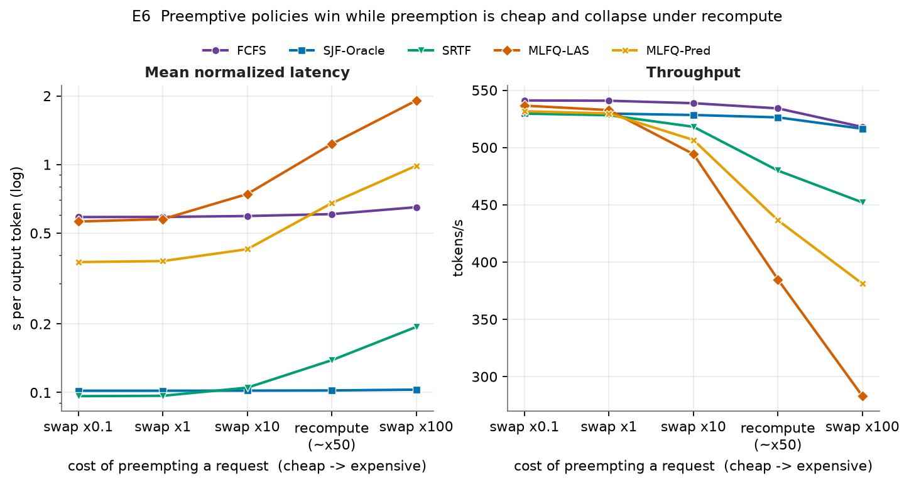

# Benchmarking LLM Inference Scheduling Policies

**Cloud Computing course project — Group 18, NITK Surathkal**
Mentor: Balaji (`balajink252is009@nitk.edu.in`)

Seven scheduling policies, one continuous-batching LLM inference engine calibrated on a real
GPU, two ways to preempt a request, compared under controlled load. The policies are compared
on identical request traces, so the *only* thing that differs between runs is the scheduling
decision.

**It runs on any laptop. No GPU, no model, no Ollama** — the one GPU step (calibration) has
already been run on a Colab T4, and its measurements are committed.

```bash
python -m venv .venv && .venv/Scripts/activate     # Linux/macOS: source .venv/bin/activate
pip install -r requirements-lock.txt               # exact versions behind results/
pytest tests/ -q                                   # 114 tests, ~30 s
python -m src.runner --all --jobs 8                # all experiments, ~2 min
python -m src.runner --all --verify                # re-run; byte-for-byte check vs results/
python -m src.plots                                # figures/ -> 9 PNGs
```

---

## Why LLM scheduling is not ordinary scheduling

A CPU scheduler picks one job to run next. An LLM inference server does not work that way,
and that difference is the whole point of this project.

Serving a request has two phases. **Prefill** processes the entire prompt in one parallel
pass and produces the first token. **Decode** then produces one further token per pass.
Nearly all of a decode pass is a fixed cost — streaming the weights, launching kernels — paid
once per pass however many sequences are in it. **On our T4, decoding 32 sequences together
costs 1.11× as much as decoding 1, not 32×.** That is the entire argument for continuous
batching.

So a real engine (Orca, vLLM) keeps a *running batch* and, between every single-token
iteration, admits new arrivals and retires finished requests. This is **continuous
batching**, and it changes the scheduling question from "who runs next?" to **"who is in
the batch?"** — with a second question when the batch or memory is full: **"who gets
thrown out, and what does that cost?"**

The binding constraint is the **KV cache**, not CPU time. Every sequence stores one cache
entry per token it has seen, in fixed-size pages. Evicting a request either throws its cache
away and rebuilds it later (**recompute**, vLLM's default) or parks it in host memory
(**swap**, which FastServe relies on). On the T4, recompute costs 35–80× a swap round trip —
and that choice turns out to decide which policies work.

## The seven policies

Each policy is deliberately just **two sort keys** (`src/policies.py`). Everything else —
batching, KV cache, preemption, timing — is shared, so any measured difference is caused by
the policy and nothing else.

| Policy | Rule | Preemptive | Uses a predictor | Why it is in the study |
|---|---|---|---|---|
| **FCFS** | arrival order | no | no | The baseline: what vLLM and Orca ship. Suffers head-of-line blocking. |
| **SJF-Oracle** | shortest true output length | no | reads the truth | Physically impossible. The theoretical best case. |
| **SJF-Pred** | shortest *predicted* length | no | yes | The realistic version; prediction error is swept. |
| **SRTF** | shortest predicted *remaining* | yes | yes | Best first-token latency — *if* preemption is cheap. |
| **MLFQ-LAS** | least attained service, 8 levels, ageing | yes | **no** | Learns length by watching service; FastServe-style. |
| **MLFQ-Pred** | MLFQ-LAS + skip-join on predicted length | yes | yes | Isolates what a predictor adds to MLFQ. |
| **Priority-SLO** | interactive first, EDF within class | no | no | The multi-tenant cloud case. |

## Calibration: what the T4 measured

[](https://colab.research.google.com/github/somyaknotfound/Cloud-Computing-T18/blob/main/calibration/colab_calibrate.ipynb)

`calibration/colab_calibrate.ipynb` timed Qwen2.5-0.5B (fp16, Hugging Face `transformers`) on
a Colab T4: 161 measurements, committed as `calibration/calibration_t4.csv`.

```
prefill(n) = max(36.8 ms, 65.9 us*n + 74.2 ns*n^2)   median error 1.7%
decode(B)  = 32.35 ms + 118 us*B                     median error 2.5%
swap(k)    = 0.26 ms + 0.94 us*k  (one way)          median error 3.8%  (= 13 GB/s, PCIe 3.0)
```

**The straight-line model we had planned failed on real data.** Prefill has a launch-overhead
floor up to ~400 tokens and then grows faster than linearly (attention is quadratic): a line
scored R² = 0.92 but a 55% median error, and predicted *negative* times for short prompts.
Decode is so flat that R² was 0.02 and two noisy settings flipped its slope negative. So the
model now has the shape the physics and the data both show, fitted robustly (Theil–Sen) and
judged by relative error. BUILD.md 4.17 has the details; a test asserts that refitting the
committed CSV reproduces the committed constants exactly.

These constants describe Hugging Face eager mode, whose ~32 ms fixed decode cost is far higher
than a production engine's: the *shape* of the laws is general, the absolute numbers are not.

## Results

All figures regenerate from the committed CSVs in `results/`; `python report/report_numbers.py`
prints every number quoted below and in the report.

### The engine saturates at 3.70 req/s — and scheduling only matters above that


Below saturation the queue is empty, the scheduler never has a decision to make, and **all
seven policies perform identically** — asserted in the test suite. Every comparison below is
an overload burst: 600 requests at 10 req/s (2.7× capacity), then the drain.

### Under recompute preemption: the classic trade-off


At 10 req/s, recompute preemption, reference trace (seed 42):

| Policy | Mean NL | TTFT p50 | Max wait | Throughput |
|---|---|---|---|---|
| FCFS | 0.606 | 34.34 s | **64.2 s** | 534 tok/s |
| SJF-Oracle | **0.102** | 0.54 s | 104.5 s | 526 tok/s |
| SRTF | 0.139 | 0.17 s | 121.9 s | 480 tok/s |
| MLFQ-LAS | 1.231 | 0.53 s | 127.6 s | 385 tok/s |
| MLFQ-Pred | 0.678 | 38.58 s | 100.6 s | 436 tok/s |
| Priority-SLO | 0.559 | 19.97 s | 82.5 s | 544 tok/s |

*Normalized latency (NL)* is end-to-end latency divided by output tokens. *Max wait* is the
longest total time any request spent queued, counting every stint after a preemption.

**SJF buys a 5.9× better average (64× better median time-to-first-token) by making the worst
case 1.6× worse.** And under recompute every preemptive policy *loses*: rebuilding evicted
caches costs SRTF 10% of throughput, and predictor-free MLFQ-LAS evicts on almost every
arrival and ends up 2× worse than FCFS.

### The cost of preemption decides which policies work



Switch only the preemption mechanism to swap (seed 42):

| Policy | Mean NL | TTFT p50 | Max wait |
|---|---|---|---|
| FCFS | 0.589 | 33.54 s | **62.1 s** |
| SJF-Oracle | 0.102 | 0.54 s | 103.8 s |
| **SRTF** | **0.097** | **0.09 s** | 104.8 s |
| MLFQ-LAS | 0.576 | 0.23 s | 64.6 s |
| MLFQ-Pred | 0.377 | 10.31 s | 65.7 s |

SRTF now draws level with SJF (never more than 1% behind on any of eleven traces) with the
fastest first tokens of any policy, and **both MLFQs keep an FCFS-level worst case**. E6 sweeps
the swap cost from 0.1× to 100× the measured value: cheaper swaps change nothing, but 10×
dearer ones already push SRTF behind SJF and MLFQ-LAS behind FCFS. The measured cost sits
comfortably on the cheap side.

### Is it the policies, or trace #42?


Ten fresh traces at three burst lengths, with 95% confidence intervals. Every headline
*direction* holds on every trace. The *size* of the effect depends on burst length — SJF's
latency ratio to FCFS is 0.31, 0.19 and 0.14 at 300, 600 and 1200 requests — and the MLFQs'
benefit shrinks on long bursts, because their fixed 30 s ageing threshold promotes more of the
queue the longer the burst lasts.

### A mediocre length predictor is good enough


| Predictor quality (rank corr.) | SJF-Pred mean NL | Benefit captured vs oracle |
|---|---|---|
| 1.00 (perfect) | 0.102 | 100% |
| 0.88 | 0.121 | 96% |
| 0.68 | 0.169 | 87% |
| 0.42 | 0.281 | 64% |
| 0.11 (nearly useless) | 0.489 | 23% |

You do not need an accurate length predictor, only one that gets the *ordering* roughly
right. MLFQ-LAS is a flat line in this figure because it never reads the prediction — and a
test asserts its output is bit-identical with a perfect and a useless predictor.

### MLFQ's ageing threshold has to follow the queueing delay


Set the threshold below the delay requests actually experience and everything is promoted to
level 0 — MLFQ quietly becomes FCFS. Calibration doubled the delays (FCFS's worst is ~62 s), so
the 30 s default now captures only 43% of the oracle's benefit for MLFQ-Pred; at **45–60 s it
captures 89–96% with a worst case within 9% of FCFS's.** Set the threshold from the observed
delay, not as a constant.

### Chunked prefill, and where the workload matters


Chunked prefill (Sarathi-Serve) is an engine mechanism, so it composes with every policy: a
64-token chunk cuts mean TPOT by 12–85% depending on policy, but it is the only chunk size that
loses throughput; 256–512-token chunks give the best throughput. On the bimodal workload SJF's
advantage over FCFS grows from 5.9× to 37×. And **strict class priority is a poor way to
protect interactive traffic**: plain SJF gives interactive requests 57.5% SLO attainment
against 6.9% for Priority-SLO, because priority redistributes queueing while SJF reduces it.

## Is the simulator trustworthy?

A simulator that only agrees with itself proves nothing.

1. **Calibration.** The timing laws fit 161 real GPU measurements to a median error under 4%.
2. **Theory gate** (`tests/test_theory.py`). Asserted, not eyeballed, on three traces — and only
   claims that held on all eleven traces we checked: SJF beats FCFS on mean latency and loses
   on worst case; no policy beats the engine's capacity ceiling; recompute costs preemptive
   policies throughput; swaps close SRTF's gap to SJF; a perfect predictor reproduces the
   oracle; MLFQ-LAS ignores the predictor; at low load all seven policies converge. Three
   claims that look like theory are deliberately *not* asserted, and the test file says why.
3. **Invariants** (`tests/test_engine.py`). No token created or lost, KV cache never
   oversubscribed and empty once drained, time monotonic, causality for every request.
4. **Determinism.** Same inputs, bit-identical outputs. `python -m src.runner --all --verify`
   re-runs every experiment and checks each CSV byte for byte; parallel and serial runs agree.
5. **Consistency with a real async server.** `serving/proxy.py` is a FastAPI server — real
   sockets, real clocks, real concurrency — that imports `src/policies.py` *unmodified*.
   `serving/loadgen.py` replays the same trace over HTTP, three times per policy, and compares
   with the simulator.

> **On the limits of check 5:** the backend is a *mock* that sleeps according to the cost
> model — no model, no GPU, no KV cache, and its prefills do not stall other decodes. So
> absolute latencies do **not** match the simulator and we do not claim they should; this is
> a consistency check of the policy code, not a hardware validation. The proxy does not
> implement preemption, so it checks the four non-preemptive policies only.

### Known limitations

- **One calibration session, of Hugging Face eager mode** — not a production engine.
- **One GPU worker.** No tensor/pipeline parallelism, multi-replica routing, or
  prefill/decode disaggregation.
- **Simplified preemption.** Swaps are charged in full and never overlapped with compute.
- **Overload bursts, not steady state.** Results depend on burst length; E7 varies it.
- **Output length is drawn from a distribution, not generated.**

## Re-calibrating (the one GPU step)

The badge above opens the notebook in Colab. It clones this repo, measures prefill, decode
and KV-swap cost on a T4, fits `cost_model.json` with `fit_cost_model.py`, and **commits both
files back to `main` itself**.

1. **Once:** create a GitHub token that can write to this repo — the repo owner makes a
   fine-grained token (only `Cloud-Computing-T18`, *Contents: Read and write*); a teammate
   who is a collaborator makes a classic token with `public_repo`. In Colab, open the key
   icon (**Secrets**) → add `GITHUB_TOKEN` → switch **Notebook access** on. Without a token
   the notebook still runs and downloads the two files instead.
2. Click the badge, **Runtime → Change runtime type → T4 GPU**, then **Runtime → Run all**
   (~3 minutes). It will not push a fit whose median error exceeds 10% for any law.
3. Back on the laptop:

```bash
git pull
python -m src.runner --all --jobs 8     # every experiment, against the new constants
python -m src.runner --all --verify     # byte-for-byte check
python -m src.plots
python report/report_numbers.py         # then update report.md from this output
python report/build_pdf.py
```

The experiments run on the laptop rather than in Colab because the committed results come
from the exact versions in `requirements-lock.txt`, which Colab does not have.

## Repository layout

```
config/          engine.yaml (batch size, KV cache, chunking, preemption) and workloads.yaml
calibration/     Colab notebook -> calibration_t4.csv -> fit_cost_model.py -> cost_model.json
src/
  cost_model.py  the seven timing constants; the only link to physical hardware
  workload.py    seeded request traces; keeps ground truth separate from what a policy may see
  policies.py    the seven policies -- two sort keys each
  engine.py      the simulator: continuous batching, KV cache, recompute and swap preemption
  metrics.py     TTFT / TPOT / E2E / normalized latency / goodput / Jain / max wait
  runner.py      the experiment sweeps E0-E7  -> results/*.csv  (--jobs, --verify)
  plots.py       the figures                  -> figures/*.png
serving/         FastAPI scheduling proxy + load generator (consistency check)
tests/           114 tests: cost model, engine invariants, policies, metrics, theory gate
report/          report.md, report_numbers.py, build_pdf.py, presentation outline
```

## Team

| Member | Roll | Owns |
|---|---|---|
| Ronak Maharia | 241CS149 | `src/engine.py`, `src/cost_model.py`, recompute & swap preemption, calibration fit |
| Chirs Tony | 241CS222 | `src/policies.py` — all seven policies, especially MLFQ-LAS and SRTF |
| Pranav Shaji | 241CS243 | `src/workload.py`, `src/metrics.py`, E7 statistics |
| Somyak Priyadarshi Mohanta | 241CS257 | `serving/`, `runner.py`, `plots.py`, report (lead) |

## References

1. Yu et al. **Orca: A Distributed Serving System for Transformer-Based Generative Models.** OSDI 2022. — iteration-level scheduling.
2. Kwon et al. **Efficient Memory Management for Large Language Model Serving with PagedAttention (vLLM).** SOSP 2023. — paged KV cache; swap and recompute preemption.
3. Wu et al. **FastServe: Iteration-Level Preemptive Scheduling for Large Language Model Inference.** NSDI 2026 (arXiv:2305.05920). — skip-join MLFQ; the basis of our MLFQ-LAS and MLFQ-Pred.
4. Agrawal et al. **Taming Throughput-Latency Tradeoff in LLM Inference with Sarathi-Serve.** OSDI 2024. — chunked prefill, stall-free batching.
5. Fu et al. **Efficient LLM Scheduling by Learning to Rank.** NeurIPS 2024. — output-length prediction for SJF-style scheduling.
6. Zhong et al. **DistServe: Disaggregating Prefill and Decoding for Goodput-optimized Large Language Model Serving.** OSDI 2024.
7. Jain, Chiu & Hawe. **A Quantitative Measure of Fairness and Discrimination.** DEC-TR-301, 1984.
