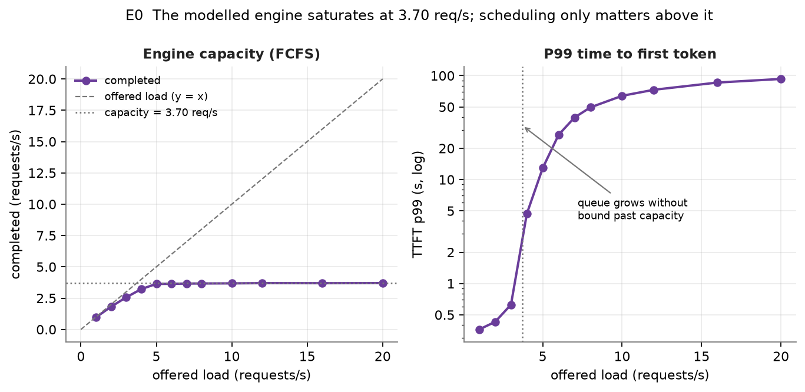
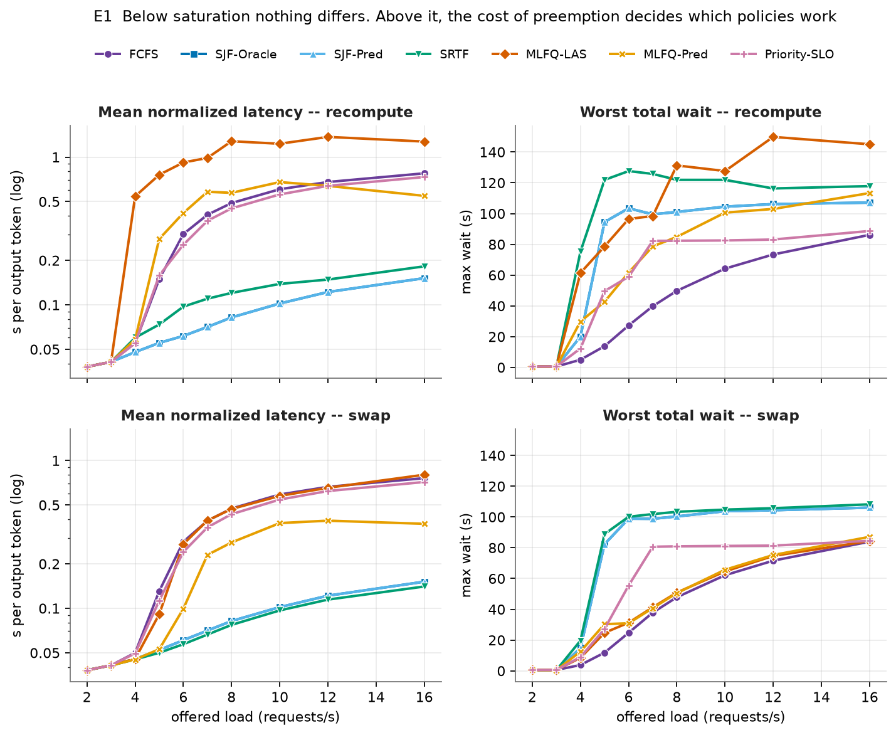
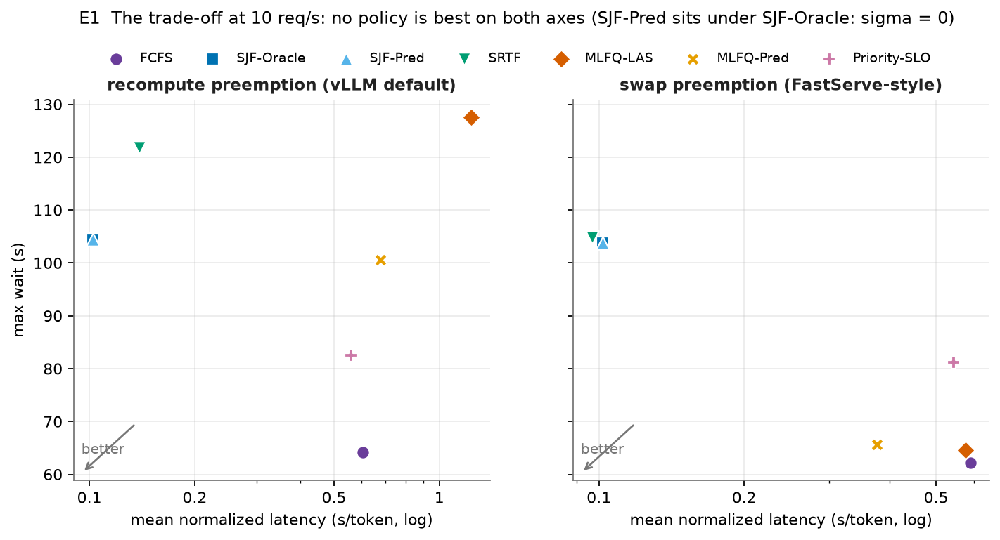
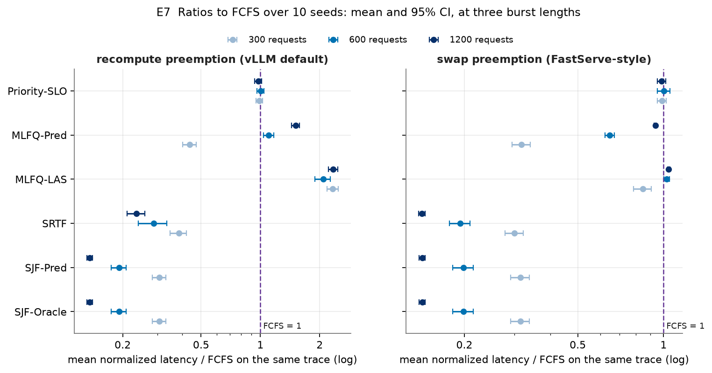
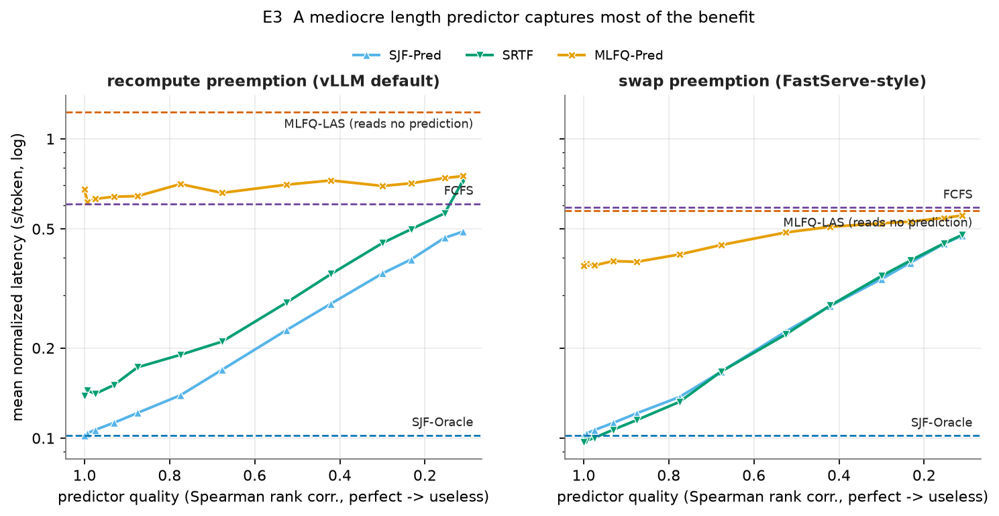
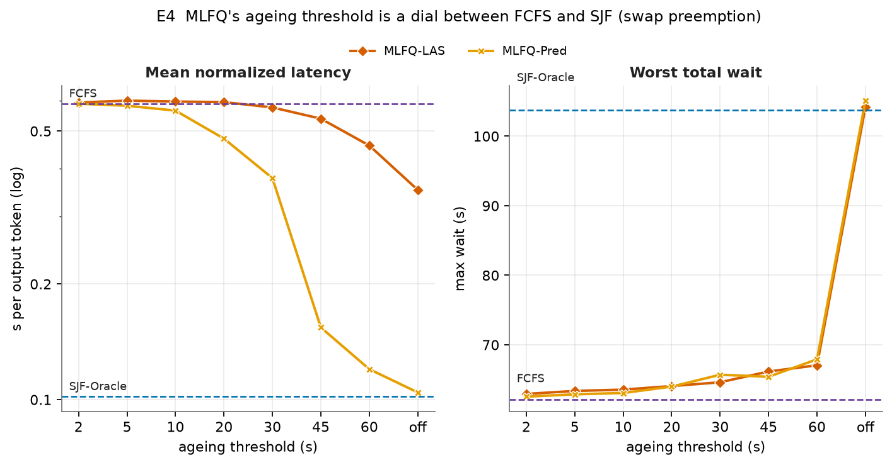
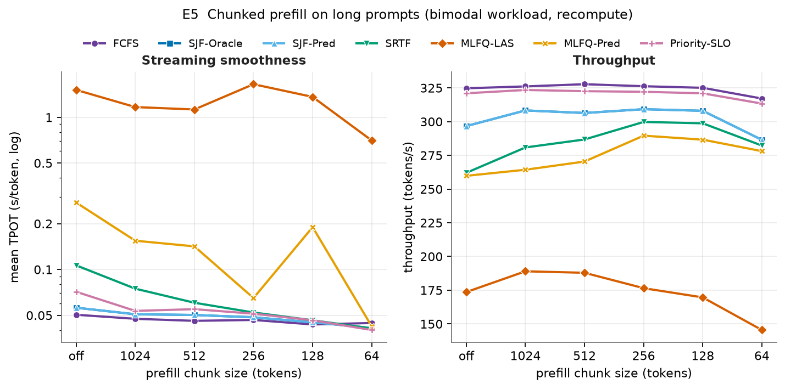
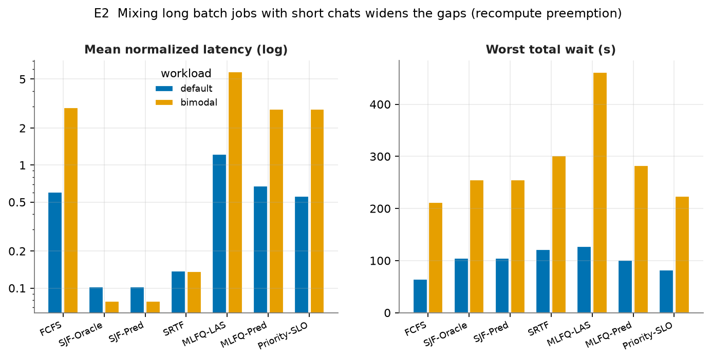

# Benchmarking Scheduling Policies for LLM Inference Serving

**Cloud Computing — Research Assignment**

**Group 18, Department of Computer Science and Engineering, NITK Surathkal**

Mentor: Balaji (`balajink252is009@nitk.edu.in`)

| Member | Roll number | Contribution |
|---|---|---|
| Ronak Maharia | 241CS149 | Simulator engine, KV cache and preemption model, cost-model fitting |
| Chirs Tony | 241CS222 | All seven scheduling policies, especially MLFQ-LAS and SRTF |
| Pranav Shaji | 241CS243 | Workload generation, metric definitions, statistical soundness |
| Somyak Priyadarshi Mohanta | 241CS257 | Serving proxy and validation, experiment runner, figures, report (lead) |

Source code: `https://github.com/somyaknotfound/Cloud-Computing-T18` — see `README.md` for the
commands that reproduce every number in this report.

---

## Abstract

Large language model inference servers do not schedule requests the way operating systems
schedule processes. They run *continuous batching*: dozens of requests share every forward
pass of the model, and the scheduler's job is not to pick who runs next but to decide who is
in the batch and, when the batch or GPU memory is full, who gets evicted. We implement seven
scheduling policies — FCFS, SJF with an oracle, SJF with a realistic predictor, SRTF, a
predictor-free multi-level feedback queue (MLFQ-LAS), the same queue with predictor-driven
skip-join (MLFQ-Pred), and an SLO-aware priority scheme — inside one discrete-event engine
model calibrated on a real GPU (a Colab T4 running Qwen2.5-0.5B), and compare them on identical
request traces under two preemption mechanisms: vLLM-style *recompute* and FastServe-style
*swap*.

Calibration was itself a result. On the T4, decoding 32 sequences costs only **1.11×** decoding
one, and the straight-line cost model we had planned failed outright on real data, so we
replaced it with forms that fit every measured point to within a few percent.

Four findings stand out. First, the classic trade-off is severe: on our reference trace,
shortest-job-first improves mean normalized latency **5.9×** over FCFS and median
time-to-first-token **64×**, while making the worst-case wait **1.6×** worse; over ten fresh
traces the latency ratio is 0.19 ± 0.02. Second, **the cost of preemption decides whether
preemptive policies work at all.** Under recompute every preemptive policy loses throughput and
the predictor-free MLFQ is about 2× *worse* than FCFS on every trace; with cheap swaps, SRTF
draws level with SJF on every trace and the MLFQs keep a near-FCFS worst case. Third,
output-length prediction is forgiving: a predictor with a Spearman rank correlation of 0.68
still captures 87% of a perfect oracle's benefit. Fourth, **strict class priority is a poor way
to protect interactive traffic**: plain SJF delivered 57.5% SLO attainment to interactive
requests against 6.9% for the SLO-aware priority policy.

---

## 1. Problem and scope

The assigned problem statement is *Benchmark Different LLM Scheduling Policies*. We
interpreted it as answering three questions:

1. **Which policy should an LLM serving system use, and under what conditions?**
2. **What does each policy cost?** Any policy that improves one metric worsens another; the
   benchmark should say which and by how much.
3. **Are the results trustworthy?** A benchmark that cannot be checked is an opinion.

Scope: a single GPU worker running one model, which is the unit that all the systems in
Section 3 schedule within. Multi-replica routing, tensor parallelism, and prefill/decode
disaggregation are out of scope and noted in Section 9.

## 2. Background: why this is not ordinary scheduling

Serving one request has two distinct phases.

**Prefill** processes the entire prompt in a single parallel pass and emits the first token.
Past a fixed launch overhead, its cost grows with the number of prompt tokens — and, through
attention, with its square.

**Decode** then emits one further token per pass. Its cost is dominated by a fixed per-pass
cost — streaming the model's weights out of GPU memory and launching the kernels — that is paid
regardless of how many sequences are in the pass. On our T4, a decode pass over 32 sequences
costs 1.11× one over a single sequence.

The consequence is decisive. If decoding 32 sequences costs barely more than decoding one, an
engine should always decode as many as it can at once. Real engines therefore keep a *running
batch* and, between every single-token iteration, admit new arrivals and retire finished
requests. This is **iteration-level (continuous) batching**, introduced by Orca [1].

Three properties follow, and they are what make LLM scheduling its own problem:

- **The scheduler chooses batch membership, not the next job.** Several requests progress
  simultaneously; "who runs next" is not the question being asked.
- **The binding resource is the KV cache, not CPU time.** Each sequence stores one cache
  entry per token it has seen. vLLM [2] manages this in fixed-size pages. Requests do not
  finish and release memory in arrival order, so the cache fills unpredictably, and when it
  does somebody must be **preempted** — either its cache is discarded and rebuilt later
  (*recompute*) or copied to host memory and back (*swap*).
- **Job "length" is unknown and unbounded.** A request's cost is its output length, which is
  not known until generation ends. Every SJF-style policy therefore depends on a
  *prediction* — which is why Section 7.5 matters.

### 2.1 Metrics

| Metric | Definition | What it captures |
|---|---|---|
| **TTFT** | first token time − arrival | Responsiveness; what a user feels as lag |
| **TPOT** | (finish − first token) / (output − 1) | Streaming smoothness |
| **E2E** | finish − arrival | Total latency |
| **Normalized latency (NL)** | E2E / output tokens | **Headline metric.** Divides out job size |
| **Goodput** | fraction meeting *both* TTFT and TPOT targets | SLO attainment |
| **Max wait** | longest total time any request spent in the queue, including every stint after a preemption | Starvation witness |
| **Jain's index** | over per-request NL [7] | Dispersion of slowdown |
| **Throughput** | output tokens / makespan (first arrival to last finish) | Capacity used, including the drain |

Normalized latency is the standard comparison metric in this literature because raw E2E
punishes long answers for being long: a 1000-token answer *should* take longer than a
10-token one, and dividing that out isolates what the scheduler did.

Max wait counts *every* stint in the queue, not just the wait for first admission. A
preemptive policy can admit a request immediately and starve it later; a metric that only
looked at first admission would never see that.

TPOT is undefined for a single-token answer (there are no gaps between tokens). We record
`NaN` and exclude those requests from TPOT statistics rather than recording 0.0, which would
silently flatter every policy's percentiles.

## 3. Related systems

**Orca** [1] introduced iteration-level scheduling. **vLLM** [2] added PagedAttention and
supports two preemption mechanisms, swapping a victim's KV cache to host memory or
recomputing it later; it schedules FCFS. **FastServe** [3] argues FCFS suffers head-of-line
blocking and proposes a skip-join MLFQ that infers request length from observed service; a
new job joins the queue indicated by its *input* length, and the system manages KV memory so
that preempted jobs can be parked in host memory cheaply. Our MLFQ-LAS and MLFQ-Pred follow
its design (Section 4.4). **Sarathi-Serve** [4] attacks a different problem — long prefills
stalling ongoing decodes — with chunked prefill, which we model as an engine toggle rather
than a policy. **Learning-to-rank scheduling** [5] predicts relative output-length ordering to
approximate SJF; our SJF-Pred is the abstract version of that idea, with predictor quality as
a knob. **DistServe** [6] disaggregates prefill and decode onto separate GPUs, which is
outside our single-worker scope.

## 4. Methodology

### 4.1 Why a calibrated simulator

Comparing scheduling policies needs many runs across many load levels, and it needs two
policies to face the *identical* request trace — otherwise trace-to-trace variance swamps the
policy effect, which with heavy-tailed length distributions it certainly does. Running that
on rented GPUs is neither affordable nor reproducible for a course project.

We therefore follow the approach common in serving research: measure the hardware once, then
simulate.

1. **Measure** prefill, decode and KV-swap cost on a real model on a real GPU (Colab T4).
2. **Fit** a cost model to those measurements.
3. **Simulate** the engine using the fitted constants.
4. **Validate** the result several separate ways (Section 6).

The boundary of this approach: absolute latencies inherit the accuracy of the cost model,
while *relative* comparisons between policies are far more robust, because every policy runs
against the same constants on the same traces.

### 4.2 Calibration on a T4, and why the planned cost model failed

`calibration/colab_calibrate.ipynb` runs Qwen2.5-0.5B-Instruct (fp16, Hugging Face
`transformers`) on a Colab T4. It times prefill at ten prompt lengths, decode at eight batch
sizes, and copying a real KV cache to pinned host memory and back at five sizes — seven
repeats each after two warm-ups, with CUDA synchronised so it measures execution rather than
queueing. The raw 161 measurements are committed as `calibration/calibration_t4.csv`, and the
notebook can clone this repository and commit its results back itself.

We had planned to fit straight lines and accept them if R² ≥ 0.9. On the real data that plan
failed in two ways, both instructive:

- **Prefill is not a straight line.** It costs a flat ~37 ms up to ~400 tokens — the pass is
  bound by launching kernels, not by arithmetic — and then grows faster than linearly, because
  attention compares every token with every earlier one. The straight line scored R² = 0.92,
  which *looks* acceptable, but its median error was **55%** and it predicted **negative**
  times for prompts under 63 tokens.
- **R² cannot judge decode.** Decode cost barely depends on batch size — the very property
  continuous batching exploits — so even a perfect fit explains little variance. Worse, two
  slow settings (batch 4 and 8) were enough to make the least-squares slope *negative*:
  R² = 0.02, and bigger batches "faster".

We therefore changed the cost model's form to the one the physics and the data both indicate,
fitted it robustly, and judged it by relative error against the measured medians:

```
t_prefill(n) = max(floor, b*n + q*n^2)     floor 36.8 ms, b 65.9 us/token, q 74.2 ns/token^2
t_decode(B)  = c + d*B                     c 32.35 ms, d 118 us/sequence
t_swap(k)    = s0 + e*k                    s0 0.26 ms, e 0.94 us/token (one way)
```

| Law | Fit | Median error | Worst point |
|---|---|---|---|
| Prefill | segmented: floor = median of short prompts, (b, q) non-negative least squares on long ones; breakpoint chosen by relative error | 1.7% | 4.7% (32 tokens) |
| Decode | Theil–Sen (median of pairwise slopes), robust to a minority of outliers | 2.5% | 36.6% (batch 4, the outlier) |
| Swap | Theil–Sen | 3.8% | 21.9% (256 tokens) |

The acceptance threshold is a median error of 10%; all three pass. The swap cost corroborates
an estimate we made before measuring: Qwen2.5-0.5B stores 12,288 bytes of KV per token, and the
fitted 0.94 µs/token is 13 GB/s — the effective bandwidth of the T4's PCIe 3.0 x16 link. A
test asserts that refitting the committed CSV reproduces the committed constants exactly.

Changing a model's form after seeing the data needs care, so we state it plainly: the linear
model was our prior, it failed by its own criterion, and the replacement is not a looser fit
but a physically motivated one — a launch-overhead floor, linear per-token work and quadratic
attention — that cuts the median prefill error from 55% to 1.7%. The raw measurements are
committed so anyone can refit them differently.

Because attention is quadratic *per sequence*, the engine passes the cost model each
sequence's prefill segment rather than a token total: eight 256-token prompts cost far less
than one 2048-token prompt, and a chunk from position s to s+k costs b·k + q·((s+k)² − s²), so
prefilling a prompt in chunks adds up to exactly the cost of prefilling it whole (asserted in
the tests).

**Caveat.** These constants describe Hugging Face `transformers` in eager mode, not a production
engine. Its ~32 ms fixed cost per decode pass is far higher than vLLM's with CUDA graphs. The
*shape* of the laws is general; the absolute numbers are specific to this stack.

### 4.3 Engine model

`src/engine.py` advances one engine iteration at a time:

1. Admit from the waiting queue in the policy's order, subject to the batch-size limit and
   free KV pages. Pages for the full prompt are reserved at admission, as vLLM does. A
   *preemptive* policy may evict running requests it ranks strictly worse than the candidate,
   to free a batch slot, KV pages, or both.
2. Form the batch. Without chunked prefill, a prefill iteration runs *alone* — every decoding
   request stalls for its duration, which is the TTFT/TPOT tension Sarathi-Serve targets.
   With chunking, prefill chunks are fused with the ongoing decodes and pay no extra floor.
3. Charge the iteration's duration from the cost model and advance the clock.
4. Emit one token per decoding sequence; a completing prefill emits the first token.
5. Grow each sequence's KV allocation. If pages run out, evict a victim chosen by the policy.

Preemption is charged in full, otherwise an aggressive policy would appear free:

- **recompute** discards the victim's KV. When it is readmitted it must re-prefill its prompt
  *plus* every token it had already generated, and that prefill stalls the whole batch.
- **swap** copies the victim's KV to host memory and back; no progress is lost, and both
  transfers are charged to the next iteration (no overlap with compute is modelled).

On the measured T4, recompute costs 35–80× a swap round trip, depending on how much KV the
victim holds (51 ms against 1.5 ms for a 500-token victim).

### 4.4 Policies as sort keys

The design decision that keeps this comparison honest and the code small: a policy is **two
sort keys**.

```python
order_key(req)    # waiting requests are admitted in increasing order of this
victim_key(req)   # when someone must be evicted, the running request with the LARGEST goes
```

Everything else — batching, memory, preemption mechanics, timing — is shared code. Any
measured difference is therefore attributable to the policy and nothing else. A policy may
only read what a real server could observe on arrival (arrival time, prompt length, class,
predicted length, and its own bookkeeping); reading true output length is reserved for
SJF-Oracle, which exists precisely to mark the unreachable bound.

| Policy | Rule | Preemptive | Reads a prediction |
|---|---|---|---|
| FCFS | arrival order | no | no |
| SJF-Oracle | true output length | no | reads the *truth* |
| SJF-Pred | predicted output length | no | yes |
| SRTF | predicted *remaining* length | yes | yes |
| MLFQ-LAS | least attained service, 8 levels | yes | **no** |
| MLFQ-Pred | MLFQ-LAS + skip-join on predicted length | yes | yes |
| Priority-SLO | interactive first, earliest TTFT deadline within class | no | no |

**MLFQ-LAS** has eight levels with quanta 16, 32, … 2048 generated tokens. Every request
starts at level 0 and is demoted as it consumes service, so it learns which requests are long
without any prediction. It must be preemptive: every request that is *waiting* has received
no service yet, so all of them sit at level 0, and ordering admissions alone would be FCFS.
The feedback only takes effect when a demoted request in the batch can be evicted for a fresh
one. Ageing promotes anything older than a threshold (default 30 s) back to level 0.
`tests/test_theory.py` asserts that MLFQ-LAS produces bit-identical results with a perfect
and a useless predictor.

**MLFQ-Pred** is identical except that a request *starts* at the level its predicted output
length would be demoted to anyway (skip-join), so an obviously long request never holds a
top-priority slot. FastServe's own skip-join keys on input length; our quanta are counted in
output tokens, so the predicted output length is the quantity on the same scale. Comparing
the two isolates exactly what a predictor adds to MLFQ.

### 4.5 Workload

Poisson arrivals; lognormal prompt and output lengths, matching the short-median heavy-tail
shape of real chat traces. The `default` workload has median prompt 244 and median output 99
tokens (p99: 884). The `bimodal` workload mixes 80% short interactive requests with 20% long
batch jobs.

Predictor quality is modelled as multiplicative lognormal noise on the true length,
`predicted = true_length * exp(Normal(0, sigma))`. We report against the resulting **Spearman
rank correlation** rather than σ, because rank correlation is what one could actually measure
for a real predictor, and SJF only cares about the ordering a predictor induces.

**Every comparison is an overload burst.** The calibrated engine saturates at 3.70 req/s
(Section 7.0). At 10 req/s — 2.7× capacity — 600 requests arrive over about 60 s and the run
ends when the queue has drained. There is no steady state above capacity — the queue grows for
as long as the burst lasts — so latencies depend on the burst length. Experiment E7 therefore
repeats the headline comparison at 300, 600 and 1200 requests. (The 10 req/s operating point
was fixed before calibration, when capacity was estimated at 5.8 req/s; we kept it rather than
re-tune it after seeing the results, and E1 reports every load from 2 to 16 req/s.)

### 4.6 Statistics and reproducibility

The single-trace sweeps (E0–E6) all use seed 42, so every policy faces the identical trace.
E7 repeats the comparison on ten fresh seeds (1–10) at three burst lengths, under both
preemption mechanisms, and reports each policy's ratio to FCFS *on the same trace* as a mean
with a 95% Student-t confidence interval, plus how many of the ten traces it beat FCFS on.

Every simulation is deterministic. `python -m src.runner --all --verify` re-runs every
experiment and checks each CSV byte for byte against the committed one; it passes with the
parallel and serial runners alike. Exact package versions are pinned in
`requirements-lock.txt`.

## 5. Implementation

Pure Python (numpy/pandas/matplotlib), no simulation framework: about 1,800 lines in `src/`,
500 in `serving/`, and 760 lines of tests across 114 test cases. Every module is
single-purpose; the largest is the engine at 430 lines, and the seven policies together come
to 268. Every experiment — 841 simulations — runs in about 2 minutes on a 12-core laptop with
`--jobs 10`.

## 6. Is the simulator trustworthy?

A simulator that only agrees with itself proves nothing. Five independent checks:

**(a) Calibration.** The timing laws are fitted to 161 measurements on a real GPU and
reproduce every measured setting to a median error under 4% (Section 4.2).

**(b) Theory gate.** `tests/test_theory.py` asserts properties that scheduling theory, or the
mechanism being modelled, requires — so a violation fails the test run rather than quietly
entering the report. A claim is admitted only if it held on all eleven traces we checked, and
each is asserted on three of them, including the two on which claims that held only for trace
42 broke:

- SJF must beat FCFS on mean normalized latency, by at least 2×, under both mechanisms.
- SJF must be *worse* on maximum wait — the price of that optimality.
- No policy may exceed the engine's ceiling of a full batch decoding back to back.
  Scheduling cannot create capacity.
- Recompute preemption must cost a preemptive policy throughput relative to swap.
- A perfect predictor must exactly reproduce the oracle.
- MLFQ-LAS must produce bit-identical results with a perfect and a useless predictor.
- MLFQ-LAS must lose to FCFS under recompute, and with swaps must beat FCFS on median TTFT
  and goodput while keeping its worst case below SJF's.
- SRTF must lose to SJF under recompute and draw level with it (within 5%) under swap.
- **At low load, all seven policies must converge.** With an empty queue the scheduler never
  has a decision to make. This is the control: a benchmark showing large differences at low
  load would be manufacturing them.

Three claims that *look* like theory are deliberately not asserted. "Every policy reaches the
same throughput" is false under continuous batching: the token rate depends on how full the
batch is, and SJF, which leaves the longest jobs for last, drains with a near-empty batch.
Across ten traces the throughput of the four non-preemptive policies differs by a median of
9.7% (maximum 14.6%) under recompute. "MLFQ-LAS beats FCFS on mean latency" only holds for
job sizes with a decreasing hazard rate; on our workload it depends on the burst length
(Section 7.3). And "SRTF strictly beats SJF with swaps" held on only 9 of 11 traces.

**(c) Consistency with a real asynchronous server.** `serving/proxy.py` is a FastAPI server —
real sockets, real clocks, real concurrency — that imports `src/policies.py` **unmodified**,
and `serving/loadgen.py` replays the same trace over HTTP. Its backend is a **mock**: no model
and no GPU, only `sleep` calls sized by the cost model. It has no KV cache and its prefills do
not stall other requests' decoding, so absolute latencies differ from the simulator and we
make no claim that they match. **This is a consistency check of the policy code, not a
hardware validation.** The proxy does not implement preemption, so it checks the four
non-preemptive policies; SRTF and both MLFQs are validated only in simulation. Each policy is
replayed three times because wall-clock runs are not bit-reproducible.

The trace uses a realistic predictor (σ = 1), so SJF-Pred and SJF-Oracle differ. Over 120
requests per replay, three replays per policy, on the calibrated constants:

| Policy | Proxy NL (mean, range over 3 replays) | Simulated NL | Proxy, relative to FCFS | Simulated, relative to FCFS |
|---|---|---|---|---|
| FCFS | 0.493 (0.492–0.495) | 0.362 | 1.000 | 1.000 |
| SJF-Oracle | 0.149 (0.148–0.149) | 0.111 | 0.301 | 0.305 |
| SJF-Pred | 0.206 (0.206–0.207) | 0.152 | 0.419 | 0.419 |
| Priority-SLO | 0.460 (0.459–0.462) | 0.336 | 0.933 | 0.927 |

**The policy ranking is identical, and every FCFS-relative ratio agrees within 0.006.** The
absolute values do not agree — the proxy's FCFS is 0.493 against the simulator's 0.362, about
1.36× — exactly as the mock backend's simplifications predict, and we do not quote them.

**(d) Invariants.** Every request completes with exactly its drawn output length; KV usage
never exceeds capacity; the cache is empty once the queue drains; time is monotonic;
causality (arrival ≤ start ≤ first token ≤ finish) holds for every request, under every
policy.

**(e) Determinism.** The same trace, policy and configuration produce bit-identical
per-request results (asserted for all seven policies), and `--verify` reproduces every
committed CSV byte for byte.

## 7. Results

### 7.0 Capacity: the axis everything is read against



The calibrated engine saturates at **3.70 req/s (≈537 tokens/s)**. At 3 req/s, TTFT p99 is
0.63 s; at 20 req/s it reaches 93 s. All policy comparisons are run at 10 req/s, in the
congested regime, because that is the only regime in which a scheduler has decisions to make.

### 7.1 Under recompute preemption: the classic trade-off




At 10 req/s, seed 42, recompute preemption (vLLM's mechanism):

| Policy | Mean NL | TTFT p50 | Max wait | Goodput | Jain | Throughput | Preemptions |
|---|---|---|---|---|---|---|---|
| FCFS | 0.606 | 34.34 s | **64.2 s** | 8.8% | 0.388 | 534 tok/s | 64 |
| SJF-Oracle | **0.102** | 0.54 s | 104.5 s | **62.5%** | 0.635 | 526 tok/s | 38 |
| SJF-Pred (σ=0) | 0.102 | 0.54 s | 104.5 s | 62.5% | 0.635 | 526 tok/s | 38 |
| SRTF | 0.139 | 0.17 s | 121.9 s | 60.3% | 0.673 | 480 tok/s | 298 |
| MLFQ-LAS | 1.231 | 0.53 s | 127.6 s | 9.0% | 0.400 | 385 tok/s | 1154 |
| MLFQ-Pred | 0.678 | 38.58 s | 100.6 s | 36.0% | 0.276 | 436 tok/s | 661 |
| Priority-SLO | 0.559 | 19.97 s | 82.5 s | 7.0% | 0.253 | 544 tok/s | 69 |

The magnitude of the head-of-line blocking effect is the striking part: FCFS's **median**
time to first token is 34 seconds, against 0.54 seconds for SJF — **64×**. Under FCFS the
median request is stuck behind a long generation; under SJF it is not. SJF improves mean
normalized latency **5.9×**. The cost is equally clear: SJF's worst wait is 105 s against
FCFS's 64 s, **1.6× worse**. FCFS has the best worst case of any policy tested, which is
precisely why it remains the default in production systems.

The preemptive policies are the surprise of this table. **Under recompute, preemption is
expensive enough to defeat them.** SRTF should match SJF and instead loses to it, giving up 10%
of throughput to rebuilding evicted caches. MLFQ-LAS evicts a request on almost every arrival
— 1154 preemptions for 600 requests — and every eviction later stalls the whole batch for a
re-prefill; it ends up 2.0× *worse* than FCFS on mean latency, with 28% less throughput.

### 7.2 The cost of preemption decides which policies work


Change only the preemption mechanism to swap and the picture changes (seed 42, 10 req/s):

| Policy | Mean NL | TTFT p50 | Max wait | Goodput | Throughput |
|---|---|---|---|---|---|
| FCFS | 0.589 | 33.54 s | **62.1 s** | 9.2% | 541 tok/s |
| SJF-Oracle | 0.102 | 0.54 s | 103.8 s | 62.5% | 530 tok/s |
| **SRTF** | **0.097** | **0.09 s** | 104.8 s | **70.8%** | 528 tok/s |
| MLFQ-LAS | 0.576 | 0.23 s | 64.6 s | 20.3% | 533 tok/s |
| MLFQ-Pred | 0.377 | 10.31 s | 65.7 s | 44.3% | 530 tok/s |
| Priority-SLO | 0.544 | 19.24 s | 81.2 s | 7.0% | 552 tok/s |

- **SRTF draws level with SJF-Oracle** — never more than 1% behind it on any of eleven traces,
  and ahead on nine of them — with the best median TTFT (0.09 s) and goodput (70.8%) of any
  policy. Under recompute it lost to SJF on every trace.
- **Both MLFQs keep a near-FCFS worst case** (65–66 s against 62 s) instead of SJF's 104 s.
  MLFQ-Pred gets 43% of the oracle's latency benefit at the default ageing threshold, and much
  more when the threshold is set relative to the actual delay (Section 7.6).
- **MLFQ-LAS, the predictor-free policy, serves a fresh request almost at once** — median TTFT
  0.23 s against FCFS's 34 s — and more than doubles goodput (20.3% vs 9.2%), at a near-FCFS
  worst case. Its *mean* latency barely moves (3% of the oracle's benefit).

E6 sweeps the swap cost to find where this flips. Making swaps 10× *cheaper* changes almost
nothing. Making them 10× *dearer* already erodes the swap results: SRTF falls behind SJF (0.105
vs 0.102) and MLFQ-LAS behind FCFS (0.743 vs 0.595), while MLFQ-Pred keeps an advantage (0.425).
At the cost of recompute (~50×) and beyond, all three lose throughput (SRTF 528 → 452 tok/s,
MLFQ-LAS 533 → 283) while FCFS and SJF barely move. The measured swap cost sits comfortably on
the cheap side of that boundary.

**This is the main result of the study.** Whether a preemptive scheduler — and in particular a
predictor-free one — is worth deploying is decided less by the policy than by what preemption
costs in the engine underneath it. FastServe's investment in KV-cache management is not an
optimisation on the side; on our evidence it is what makes its scheduler viable.

### 7.3 Is it the policies, or trace #42?



E7 repeats the comparison on ten fresh traces at 300, 600 and 1200 requests. At 600 requests
(ratio to FCFS on the same trace, mean ± 95% CI, and traces on which the policy beat FCFS):

| Policy | Recompute: NL ratio | Recompute: max-wait ratio | Swap: NL ratio | Swap: max-wait ratio |
|---|---|---|---|---|
| SJF-Oracle | 0.19 ± 0.02 (10/10) | 1.49 ± 0.09 | 0.20 ± 0.02 (10/10) | 1.54 ± 0.10 |
| SRTF | 0.29 ± 0.05 (10/10) | 1.71 ± 0.12 | 0.19 ± 0.02 (10/10) | 1.56 ± 0.09 |
| MLFQ-LAS | 2.08 ± 0.18 (0/10) | 2.04 ± 0.24 | 1.03 ± 0.02 (1/10) | 1.03 ± 0.01 |
| MLFQ-Pred | 1.10 ± 0.07 (2/10) | 1.46 ± 0.09 | 0.65 ± 0.02 (10/10) | 1.03 ± 0.01 |
| Priority-SLO | 1.00 ± 0.04 (6/10) | 1.23 ± 0.05 | 1.00 ± 0.05 (6/10) | 1.26 ± 0.05 |

Three things this adds that a single trace could not:

1. **The direction of every headline result holds on every trace.** SJF beats FCFS on 10/10;
   MLFQ-LAS loses to FCFS on 10/10 with recompute; MLFQ-Pred beats FCFS on 10/10 with swaps at
   an FCFS-level worst case (1.03 ± 0.01).
2. **The size of the effect is a property of the burst, not a constant.** SJF's latency ratio
   to FCFS is 0.31 on 300-request bursts, 0.19 on 600 and 0.14 on 1200: the longer the queue
   grows, the more head-of-line blocking FCFS suffers. "5.9× on trace 42" should be read as
   "about 5× over a one-minute burst at 2.7× capacity".
3. **The MLFQs only help on short bursts at the default threshold.** With swaps, MLFQ-LAS's
   ratio to FCFS is 0.84 ± 0.06 on 300-request bursts but ≈1.0 on 600 and 1200; MLFQ-Pred's is
   0.32, 0.65 and 0.94. The ageing threshold is fixed at 30 s; the longer the burst, the more
   requests outlive it and are promoted back to level 0, and the feedback queue degenerates
   toward FCFS — the trap of Section 7.6, measured rather than anecdotal.

### 7.4 Two notions of fairness that disagree

Jain's index *rises* under SJF (0.635) compared with FCFS (0.388), while maximum wait gets
much worse. This looks contradictory and is not: the two measure different things. Jain's
index over normalized latency measures how *uniform* slowdown is, and FCFS is badly
non-uniform — short requests wait as long as long ones but have far fewer tokens to amortise
that wait over, so their normalized latency is terrible. SJF equalises that. Meanwhile max
wait asks a different question: is any *individual* request being abandoned?

**A single fairness number would have hidden this.** Reporting both is the reason we can say
SJF is simultaneously more uniform *and* more prone to starvation.

### 7.5 How good does a length predictor have to be?



Since SJF's advantage rests on knowing output lengths, the question that decides whether any
of this is deployable is how accurate a predictor must be. Recompute preemption, seed 42:

| Predictor rank correlation | SJF-Pred mean NL | Oracle benefit captured |
|---|---|---|
| 1.00 (perfect) | 0.102 | 100% |
| 0.88 | 0.121 | 96% |
| 0.68 | 0.169 | 87% |
| 0.42 | 0.281 | 64% |
| 0.23 | 0.395 | 42% |
| 0.11 (nearly useless) | 0.489 | 23% |

**Prediction is far more forgiving than expected.** A predictor with rank correlation 0.68 —
mediocre by any standard — still captures 87% of a perfect oracle's benefit (the same under
swap), and SJF-Pred remains better than FCFS even at rank correlation 0.11.

The practical reading: a serving system does not need an accurate length predictor, only one
that gets the *ordering* roughly right — consistent with the learning-to-rank framing of [5].
Two further points from Figure 4: with swaps, SRTF tracks SJF-Pred at every predictor quality;
and MLFQ-Pred is worse than SJF-Pred at every predictor quality — its advantage is the worst
case, not the mean.

### 7.6 MLFQ's ageing threshold, and two traps



Under swap preemption the ageing threshold is a dial between the two extremes (seed 42):

| Ageing threshold | MLFQ-Pred: oracle benefit | MLFQ-Pred: max wait vs FCFS | MLFQ-LAS: oracle benefit | MLFQ-LAS: max wait vs FCFS |
|---|---|---|---|---|
| 10 s | 5% | 1.01× | −2% | 1.02× |
| 30 s (default) | 43% | 1.06× | 3% | 1.04× |
| 45 s | **89%** | **1.05×** | 10% | 1.06× |
| 60 s | **96%** | **1.09×** | 27% | 1.08× |
| off | 99% | 1.69× | 49% | 1.68× |

MLFQ-Pred has a clear knee: at 45–60 s it reaches 89–96% of the oracle's benefit with a worst
case within 9% of FCFS's, against SJF's 67% worse. MLFQ-LAS has no comparable knee: without a
predictor, its latency only improves as its worst case grows.

**The parameter is only meaningful relative to the delay the system actually experiences.** On
the calibrated engine, queueing delays under FCFS reach about 62 s, so the 30 s default is
below them and both variants spend much of the burst promoted back to level 0. We had made
exactly this mistake once before: our first MLFQ used a 10 s threshold against ~30 s delays
and performed identically to FCFS. Calibration roughly doubled the delays and moved the knee
from about 30 s to 45–60 s — which is the lesson, stated as a rule: **set the ageing threshold
from the observed queueing delay, not as a constant.** We kept the 30 s default in every other
experiment rather than re-tune it after seeing the results.

A second, more serious mistake shaped the final design. Our first MLFQ placed each arrival
with skip-join on `predicted_len` — and in the headline experiment that prediction was exact,
so the "predictor-free" policy was quietly reading the oracle. It appeared to capture 90% of
SJF's benefit without a predictor. With the prediction removed it was *worse* than FCFS,
because a non-preemptive feedback queue cannot demote anything that is already running. That
is why the final MLFQ-LAS is preemptive, why MLFQ-Pred exists as a separate policy, and why a
test now asserts that MLFQ-LAS's output is bit-identical with a perfect and a useless
predictor. The full list of corrections is in the Appendix.

### 7.7 Chunked prefill



On the long-prompt bimodal workload (recompute), a 64-token chunk reduces mean TPOT relative to
no chunking by 12% for FCFS, 27% for SJF, 44% for Priority-SLO, 61% for SRTF and 85% for
MLFQ-Pred — the more a policy interleaves prefills with decodes, the more it gains from fusing
them. But 64 tokens is the only chunk size that *loses* throughput relative to no chunking
(FCFS 317 vs 325 tok/s, SJF 287 vs 297), and it also raises time to first token, because a long
prompt now takes many passes to finish. Throughput peaks at 256–512-token chunks. Chunk size is
the TTFT-versus-TPOT dial; **256–512 tokens** was the best compromise here.

Chunking barely registers on the `default` workload, whose median prompt (244 tokens) is
smaller than most chunk sizes tested — a reminder that an engine optimisation can only be
evaluated on a workload that actually exercises it.

### 7.8 Workload sensitivity, and the Priority-SLO surprise



On the bimodal workload the ranking is unchanged but the gaps widen: SJF's advantage over FCFS
grows from 5.9× to **37×**, since mixing long batch jobs with short chats is exactly the
situation head-of-line blocking punishes.

The unexpected result concerns **Priority-SLO**, which we included as the "obvious" answer for
multi-tenant serving: mark interactive traffic high priority and serve it first. It does help
interactive requests relative to FCFS (goodput 6.9% vs 5.5%) at the expected cost to batch
traffic (7.3% vs 16.8%). But (default workload, recompute):

| Policy | Interactive goodput | Batch goodput | Overall |
|---|---|---|---|
| FCFS | 5.5% | 16.8% | 8.8% |
| **Priority-SLO** | 6.9% | 7.3% | 7.0% |
| **SJF-Oracle** | **57.5%** | **74.3%** | **62.5%** |

**Plain SJF delivers more than eight times the SLO attainment to interactive traffic that the
explicitly SLO-aware policy does — while also being better for batch traffic.** The reason is
that at high load, SLO attainment is dominated by *total* queueing delay. Class priority
redistributes queueing; it does not reduce it. Shortest-job-first reduces it, and because
short requests are also the ones with tight SLOs, most of the benefit lands where it is needed
without anyone having to declare priorities at all. Over ten traces Priority-SLO's mean latency
is indistinguishable from FCFS's (ratio 1.00 ± 0.04).

The design lesson: **reducing overall queueing beats reallocating it.** Priority classes are
worth adding on top of a good policy, not instead of one.

## 8. Discussion: what we would actually deploy

- **Under saturation, do nothing.** Below the knee no policy beats another. Capacity planning
  dominates scheduling; if a system runs below saturation, this entire question is moot.
- **On an engine that can only recompute (vLLM's default path), use non-preemptive SJF with a
  length predictor**, even a mediocre one, and avoid preemptive policies: every one we tested
  lost throughput, and the predictor-free MLFQ was worse than doing nothing.
- **If preemption is cheap (KV swapping), preemption pays.** With a predictor, SRTF matches
  SJF's mean latency with the fastest first tokens; MLFQ-Pred with the ageing threshold set
  near the observed queueing delay gives near-oracle latency at a near-FCFS worst case.
  Without a predictor, MLFQ-LAS reliably buys fast first tokens and higher goodput, but not
  lower mean latency on long bursts.
- **Do not invest in making the predictor accurate.** Ordering is what matters.
- **Do not reach for priority classes first.** Fix queueing before reallocating it.
- **Keep FCFS if the worst case is what you are judged on.** It had the best maximum wait of
  every policy tested. That is a real, defensible reason to keep it.

## 9. Limitations

- **One calibration, of one software stack.** The constants come from a single Colab session
  of Hugging Face `transformers` in eager mode, whose fixed per-pass cost is far higher than a
  production engine's. The decode fit discounts one outlying batch size; a second session
  would show how stable the constants are.
- **Single GPU worker.** No tensor/pipeline parallelism, multi-replica routing, or
  prefill/decode disaggregation [6].
- **Simplified preemption.** Swap transfers are charged in full and never overlapped with
  compute, and host memory is unlimited; recompute pays the full re-prefill. Real engines sit
  somewhere between these extremes.
- **Overload bursts, not steady state.** Above capacity there is no steady state; results
  depend on burst length, which E7 varies but does not exhaust.
- **Output lengths are drawn, not generated.** Real output length correlates with prompt
  content; our predictor noise is deliberately content-blind.
- **The consistency check uses a mock backend and no preemption** (Section 6c). The preemptive
  policies are validated only in simulation.
- **One model size.** A 70B model has a much larger fixed decode cost, which would strengthen
  the case for batching and change the saturation point.

## 10. Conclusion

Continuous batching changes the scheduling question, but the classical trade-off survives it
intact and sharpened. Prioritising short requests improves mean normalized latency about 5×
and median TTFT 64× over a one-minute overload burst, at the cost of a 1.6× worse worst case.

The result we think matters most is that **the cost of preemption decides which schedulers
are viable.** With vLLM-style recompute, preemptive policies — SRTF and both MLFQs — lose
throughput and, for the predictor-free MLFQ, everything else too. With cheap swaps, SRTF draws
level with SJF on every trace and MLFQ-Pred, its ageing threshold set from the observed delay,
reaches near-oracle latency at a near-FCFS worst case. Two further results carry over
regardless: **length prediction is forgiving** (87% of the benefit at rank correlation 0.68),
and **reducing queueing beats reallocating it** — plain SJF protected interactive traffic more
than eight times better than an explicitly SLO-aware priority policy.

## 11. Reproducibility

```bash
pip install -r requirements-lock.txt          # exact versions used for the committed results
pytest tests/ -q                              # 114 tests including the theory gate
python -m src.runner --all --jobs 8           # every experiment     -> results/*.csv  (~2 min)
python -m src.runner --all --verify           # re-run; byte-for-byte check against results/
python -m src.plots                           # every figure         -> figures/*.png
python serving/loadgen.py                     # proxy consistency check (~25 min, no GPU)
python report/report_numbers.py               # every number quoted in this report
python calibration/fit_cost_model.py          # refit the committed T4 measurements
```

All simulations are seeded and deterministic; two policies are always compared on the
identical trace. The only step requiring a GPU is `calibration/colab_calibrate.ipynb`, run
once on Colab; its measurements are committed so nobody else needs one.

## Appendix: corrections

The first draft of this project (2026-08-24) was audited before submission, and calibration
later tested the cost model against a real GPU. Each item below changed a claim; all were
found by checking the code and results against the text.

| Earlier version said | What was wrong | Now |
|---|---|---|
| MLFQ-LAS "needs no predictor" and "captures 90% of the oracle's benefit" | Its skip-join read `predicted_len`, which was exact in the headline run | Predictor-free MLFQ-LAS is preemptive and asserted to ignore predictions; the old behaviour is MLFQ-Pred |
| "Throughput is identical for every policy" (spread < 2%) | True for trace 42 only | Differs by ~10% between non-preemptive policies; no longer asserted |
| SRTF is preemptive | It only ever evicted under KV pressure, never for a batch slot | Preemptive policies may evict for a slot or for memory |
| `preemption_mode: recompute` in the config | The key was loaded and ignored | Recompute and swap are both implemented and compared |
| Max queue delay as the starvation witness | Only counted the wait for first admission | Max wait counts every stint in the queue |
| Results from one trace | No measure of variability | E7: ten seeds, three burst lengths, 95% CIs |
| Timing constants "calibrated from measurements" | The notebook had not been run | It has now; Section 4.2 |
| A linear cost model, accepted at R² ≥ 0.9 | On the T4: 55% median prefill error, negative times, a negative decode slope | Floor + quadratic prefill, robust fits, judged by relative error |
| With swaps, "SRTF beats SJF on every trace" (provisional constants) | On the measured constants, 9 of 11 traces | Asserted only that swaps close SRTF's gap to within 5% |
| MLFQ-Pred "90% of the oracle at a 30 s threshold" (provisional constants) | Measured delays are twice as long; 30 s now gives 43% | The threshold must follow the observed delay: 89–96% at 45–60 s |
| A "real server" validation | The backend is a mock that sleeps | Called a consistency check; preemptive policies excluded |
| FastServe reports "2.1–6.1×" over vLLM | Not found in any version of the paper | Claim removed; title corrected |

## References

1. G.-I. Yu et al. "Orca: A Distributed Serving System for Transformer-Based Generative Models." *OSDI*, 2022.
2. W. Kwon et al. "Efficient Memory Management for Large Language Model Serving with PagedAttention." *SOSP*, 2023. arXiv:2309.06180.
3. B. Wu et al. "FastServe: Iteration-Level Preemptive Scheduling for Large Language Model Inference." *NSDI*, 2026. arXiv:2305.05920.
4. A. Agrawal et al. "Taming Throughput-Latency Tradeoff in LLM Inference with Sarathi-Serve." *OSDI*, 2024. arXiv:2403.02310.
5. Y. Fu et al. "Efficient LLM Scheduling by Learning to Rank." *NeurIPS*, 2024. arXiv:2408.15792.
6. Y. Zhong et al. "DistServe: Disaggregating Prefill and Decoding for Goodput-optimized Large Language Model Serving." *OSDI*, 2024. arXiv:2401.09670.
7. R. Jain, D.-M. Chiu, W. Hawe. "A Quantitative Measure of Fairness and Discrimination for Resource Allocation in Shared Computer Systems." DEC-TR-301, 1984.
